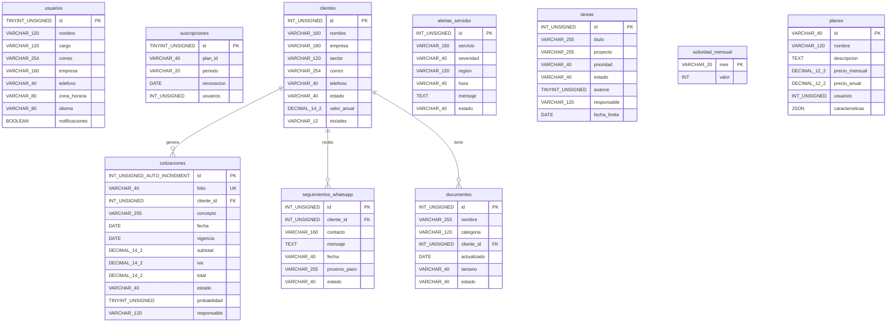

# Tsoli CRM — prototipo

## Descripción y alcance

Tsoli CRM es un prototipo de una interfaz CRM para gestionar clientes y dar seguimiento a la operación comercial. Incluye vistas de inicio, proyectos y cotizaciones, documentos, base de datos, configuración, planes y un copiloto IA.

La aplicación es una demostración local: `seed.js` crea `tsoli_crm` e inserta datos ficticios. El inicio de sesión no autentica usuarios y no debe usarse como control de acceso en producción.

## Integrantes
Jeset Eliu Navarro Cano
Kamila Eunice Perez Caballero
Alejandro Avila Moreno

## Stack tecnológico

- Node.js con módulos ES.
- Express 4 para servidor y rutas.
- EJS para renderizar las vistas.
- Tailwind CSS cargado desde CDN en las vistas.
- MySQL administrado localmente con XAMPP.
- OpenRouter (`openrouter/free`) mediante el SDK de OpenAI.
- `mysql2/promise` para las conexiones MySQL.

## Instalación y ejecución local

### Requisitos

- Node.js 20.12 o posterior.
- XAMPP con MySQL habilitado.
- Una API key de OpenRouter para usar el copiloto.

### 1. Instalar dependencias

Desde la raíz del repositorio:

```powershell
npm install
```

### 2. Configurar el entorno

Crea `.env` en la raíz del proyecto:

```dotenv
PORT=3000
DB_HOST=localhost
DB_PORT=3306
DB_NAME=tsoli_crm
DB_USER=root
DB_PASSWORD=
DB_RO_USER=tsoli_readonly
DB_RO_PASSWORD=cambia_esta_clave
OPENROUTER_API_KEY=pega_aqui_tu_api_key
```

`DB_USER` y `DB_PASSWORD` se usan para la conexión general y para inicializar el esquema. `DB_RO_USER` y `DB_RO_PASSWORD` son las credenciales separadas del pool de consultas del agente. En una instalación local estándar de XAMPP, MySQL suele aceptar `root` sin contraseña; ajusta esos valores si tu instalación tiene otra configuración.

### 3. Crear la base y cargar los datos

Inicia MySQL desde el panel de XAMPP y ejecuta:

```powershell
node seed.js
```

El script crea la base `tsoli_crm`, crea sus tablas y carga los datos ficticios desde `data/db.json`. El usuario configurado como `DB_USER` debe poder crear la base y las tablas.

### 4. Crear el usuario MySQL de solo lectura

En phpMyAdmin o en el cliente de MySQL, ejecuta después de crear la base:

```sql
CREATE USER 'tsoli_readonly'@'localhost' IDENTIFIED BY 'cambia_esta_clave';
GRANT SELECT ON tsoli_crm.* TO 'tsoli_readonly'@'localhost';
```

Usa la misma contraseña en `DB_RO_PASSWORD`. Si el usuario ya existe, cambia su contraseña con `ALTER USER` en lugar de volver a ejecutar `CREATE USER`. Este usuario solo recibe permiso `SELECT` sobre `tsoli_crm`.

### 5. Arrancar y probar

```powershell
npm start
```

Abre <http://localhost:3000>. Para ejecutar las pruebas:

```powershell
npm test
```

## Arquitectura

- `server.js`: configura Express, EJS, middleware, archivos estáticos y montaje de rutas. Comprueba la conexión MySQL antes de escuchar en el puerto.
- `routes/pages.js`: rutas que cargan las vistas.
- `routes/actions.js`: endpoints de formularios, acciones CRM y `POST /api/chat`.
- `views/`: plantillas EJS y componentes compartidos.
- `public/`: recursos estáticos del cliente.
- `config/db.js`: pool general y pool `roPool`; este último conecta a `tsoli_crm` con `DB_RO_USER`/`DB_RO_PASSWORD`, con fallback a las credenciales generales.
- `config/schema.js`: diccionario usado como contexto para generar consultas del agente.
- `seed.js`: definición de tablas y carga inicial de datos desde `data/db.json`.

## Esquema de Base de Datos

El esquema corresponde a las sentencias `CREATE TABLE` de `seed.js` y al diccionario de `config/schema.js`. Todas las columnas son efectivamente `NOT NULL`; el DDL no declara valores `DEFAULT`. En el diagrama, los nombres de tipos reemplazan espacios y paréntesis por guiones bajos (por ejemplo, `VARCHAR_120` representa `VARCHAR(120)`); las tablas siguientes muestran el tipo SQL exacto. `PK` es llave primaria, `FK` es llave foránea y `UK` es llave única.

### Diagrama Entidad-Relación



Las relaciones indican que cada cotización, seguimiento y documento pertenece a exactamente un cliente; un cliente puede tener cero o muchos de esos registros. `suscripciones.plan_id` no tiene una FK declarada hacia `planes.id` en el DDL.

### Diccionario de Datos

En las restricciones, `DEFAULT —` significa que el DDL no define un valor predeterminado para esa columna. Las llaves primarias son `NOT NULL` por definición de MySQL; las demás columnas tienen `NOT NULL` declarado explícitamente.

#### `usuarios`

| Columna | Tipo SQL | Restricción | Descripción funcional |
|---|---|---|---|
| `id` | `TINYINT UNSIGNED` | PK, NOT NULL; DEFAULT — | Identificador del usuario de la cuenta. |
| `nombre` | `VARCHAR(120)` | NOT NULL; DEFAULT — | Nombre mostrado del usuario. |
| `cargo` | `VARCHAR(120)` | NOT NULL; DEFAULT — | Cargo o puesto del usuario. |
| `correo` | `VARCHAR(254)` | NOT NULL; DEFAULT — | Correo electrónico del usuario. |
| `empresa` | `VARCHAR(160)` | NOT NULL; DEFAULT — | Empresa asociada a la cuenta. |
| `telefono` | `VARCHAR(40)` | NOT NULL; DEFAULT — | Teléfono de contacto. |
| `zona_horaria` | `VARCHAR(80)` | NOT NULL; DEFAULT — | Zona horaria configurada para el usuario. |
| `idioma` | `VARCHAR(80)` | NOT NULL; DEFAULT — | Idioma configurado para la interfaz. |
| `notificaciones` | `BOOLEAN` | NOT NULL; DEFAULT — | Indica si las notificaciones están habilitadas. |

#### `suscripciones`

| Columna | Tipo SQL | Restricción | Descripción funcional |
|---|---|---|---|
| `id` | `TINYINT UNSIGNED` | PK, NOT NULL; DEFAULT — | Identificador del registro de suscripción. |
| `plan_id` | `VARCHAR(40)` | NOT NULL; DEFAULT — | Identificador del plan asignado; el DDL no declara una FK a `planes`. |
| `periodo` | `VARCHAR(20)` | NOT NULL; DEFAULT — | Periodicidad de la suscripción. |
| `renovacion` | `DATE` | NOT NULL; DEFAULT — | Fecha de renovación. |
| `usuarios` | `INT UNSIGNED` | NOT NULL; DEFAULT — | Cantidad de usuarios incluida en la suscripción. |

#### `clientes`

| Columna | Tipo SQL | Restricción | Descripción funcional |
|---|---|---|---|
| `id` | `INT UNSIGNED` | PK, NOT NULL; DEFAULT — | Identificador del cliente. |
| `nombre` | `VARCHAR(160)` | NOT NULL; DEFAULT — | Nombre del contacto o cliente. |
| `empresa` | `VARCHAR(180)` | NOT NULL; DEFAULT — | Empresa del cliente. |
| `sector` | `VARCHAR(120)` | NOT NULL; DEFAULT — | Sector de actividad del cliente. |
| `correo` | `VARCHAR(254)` | NOT NULL; DEFAULT — | Correo de contacto. |
| `telefono` | `VARCHAR(40)` | NOT NULL; DEFAULT — | Teléfono de contacto. |
| `estado` | `VARCHAR(40)` | NOT NULL; DEFAULT — | Estado comercial del cliente. |
| `valor_anual` | `DECIMAL(14, 2)` | NOT NULL; DEFAULT — | Valor anual estimado asociado al cliente. |
| `iniciales` | `VARCHAR(12)` | NOT NULL; DEFAULT — | Iniciales usadas para identificar al cliente en la interfaz. |

#### `cotizaciones`

| Columna | Tipo SQL | Restricción | Descripción funcional |
|---|---|---|---|
| `id` | `INT UNSIGNED` | PK, NOT NULL, AUTO_INCREMENT; DEFAULT — | Identificador generado para la cotización. |
| `folio` | `VARCHAR(40)` | UNIQUE, NOT NULL; DEFAULT — | Folio único de la cotización. |
| `cliente_id` | `INT UNSIGNED` | FK → `clientes.id`, NOT NULL; DEFAULT — | Cliente al que pertenece la cotización. |
| `concepto` | `VARCHAR(255)` | NOT NULL; DEFAULT — | Concepto o descripción comercial. |
| `fecha` | `DATE` | NOT NULL; DEFAULT — | Fecha de emisión. |
| `vigencia` | `DATE` | NOT NULL; DEFAULT — | Fecha hasta la que es válida. |
| `subtotal` | `DECIMAL(14, 2)` | NOT NULL; DEFAULT — | Importe antes de impuestos. |
| `iva` | `DECIMAL(14, 2)` | NOT NULL; DEFAULT — | Importe del IVA. |
| `total` | `DECIMAL(14, 2)` | NOT NULL; DEFAULT — | Importe total. |
| `estado` | `VARCHAR(40)` | NOT NULL; DEFAULT — | Estado de la cotización. |
| `probabilidad` | `TINYINT UNSIGNED` | NOT NULL; DEFAULT — | Probabilidad de cierre expresada como entero. |
| `responsable` | `VARCHAR(120)` | NOT NULL; DEFAULT — | Persona responsable de la cotización. |

#### `alertas_servidor`

| Columna | Tipo SQL | Restricción | Descripción funcional |
|---|---|---|---|
| `id` | `INT UNSIGNED` | PK, NOT NULL; DEFAULT — | Identificador de la alerta. |
| `servicio` | `VARCHAR(160)` | NOT NULL; DEFAULT — | Servicio que generó la alerta. |
| `severidad` | `VARCHAR(40)` | NOT NULL; DEFAULT — | Nivel de severidad. |
| `region` | `VARCHAR(120)` | NOT NULL; DEFAULT — | Región asociada al evento. |
| `hora` | `VARCHAR(40)` | NOT NULL; DEFAULT — | Hora registrada para la alerta. |
| `mensaje` | `TEXT` | NOT NULL; DEFAULT — | Descripción del evento. |
| `estado` | `VARCHAR(40)` | NOT NULL; DEFAULT — | Estado de atención de la alerta. |

#### `seguimientos_whatsapp`

| Columna | Tipo SQL | Restricción | Descripción funcional |
|---|---|---|---|
| `id` | `INT UNSIGNED` | PK, NOT NULL; DEFAULT — | Identificador del seguimiento. |
| `cliente_id` | `INT UNSIGNED` | FK → `clientes.id`, NOT NULL; DEFAULT — | Cliente relacionado con el seguimiento. |
| `contacto` | `VARCHAR(160)` | NOT NULL; DEFAULT — | Contacto asociado a la conversación. |
| `mensaje` | `TEXT` | NOT NULL; DEFAULT — | Mensaje o contexto del seguimiento. |
| `fecha` | `VARCHAR(40)` | NOT NULL; DEFAULT — | Fecha registrada para el seguimiento. |
| `proximo_paso` | `VARCHAR(255)` | NOT NULL; DEFAULT — | Acción comercial siguiente. |
| `estado` | `VARCHAR(40)` | NOT NULL; DEFAULT — | Estado del seguimiento. |

#### `documentos`

| Columna | Tipo SQL | Restricción | Descripción funcional |
|---|---|---|---|
| `id` | `INT UNSIGNED` | PK, NOT NULL; DEFAULT — | Identificador del documento. |
| `nombre` | `VARCHAR(255)` | NOT NULL; DEFAULT — | Nombre del documento. |
| `categoria` | `VARCHAR(120)` | NOT NULL; DEFAULT — | Categoría documental. |
| `cliente_id` | `INT UNSIGNED` | FK → `clientes.id`, NOT NULL; DEFAULT — | Cliente relacionado con el documento. |
| `actualizado` | `DATE` | NOT NULL; DEFAULT — | Fecha de última actualización. |
| `tamano` | `VARCHAR(40)` | NOT NULL; DEFAULT — | Tamaño presentado para el documento. |
| `estado` | `VARCHAR(40)` | NOT NULL; DEFAULT — | Estado del documento. |

#### `tareas`

| Columna | Tipo SQL | Restricción | Descripción funcional |
|---|---|---|---|
| `id` | `INT UNSIGNED` | PK, NOT NULL; DEFAULT — | Identificador de la tarea. |
| `titulo` | `VARCHAR(255)` | NOT NULL; DEFAULT — | Título de la tarea. |
| `proyecto` | `VARCHAR(255)` | NOT NULL; DEFAULT — | Proyecto relacionado. |
| `prioridad` | `VARCHAR(40)` | NOT NULL; DEFAULT — | Prioridad asignada. |
| `estado` | `VARCHAR(40)` | NOT NULL; DEFAULT — | Estado de avance de la tarea. |
| `avance` | `TINYINT UNSIGNED` | NOT NULL; DEFAULT — | Porcentaje de avance registrado. |
| `responsable` | `VARCHAR(120)` | NOT NULL; DEFAULT — | Persona responsable de la tarea. |
| `fecha_limite` | `DATE` | NOT NULL; DEFAULT — | Fecha límite. |

#### `actividad_mensual`

| Columna | Tipo SQL | Restricción | Descripción funcional |
|---|---|---|---|
| `mes` | `VARCHAR(20)` | PK, NOT NULL; DEFAULT — | Etiqueta del mes que identifica el registro. |
| `valor` | `INT` | NOT NULL; DEFAULT — | Valor de actividad registrado para el mes. |

#### `planes`

| Columna | Tipo SQL | Restricción | Descripción funcional |
|---|---|---|---|
| `id` | `VARCHAR(40)` | PK, NOT NULL; DEFAULT — | Identificador del plan. |
| `nombre` | `VARCHAR(120)` | NOT NULL; DEFAULT — | Nombre comercial del plan. |
| `descripcion` | `TEXT` | NOT NULL; DEFAULT — | Descripción del plan. |
| `precio_mensual` | `DECIMAL(12, 2)` | NOT NULL; DEFAULT — | Precio mensual. |
| `precio_anual` | `DECIMAL(12, 2)` | NOT NULL; DEFAULT — | Precio anual. |
| `usuarios` | `INT UNSIGNED` | NOT NULL; DEFAULT — | Cantidad de usuarios incluida en el plan. |
| `caracteristicas` | `JSON` | NOT NULL; DEFAULT — | Características del plan en formato JSON. |

## Agente IA: Text-to-SQL

`POST /api/chat` procesa preguntas en dos fases:

1. **Traducción y consulta.** Envía la pregunta y el diccionario de `config/schema.js` a OpenRouter (`openrouter/free`). El modelo devuelve JSON con `needs_db` y un `SELECT`, o una respuesta directa si la pregunta no requiere consultar la base. Antes de ejecutar, el servidor exige que la consulta empiece con `SELECT`, quita un `;` terminal y rechaza puntos y coma intermedios, comentarios, palabras SQL de escritura y operaciones de lectura con efectos o bloqueos. La ejecución usa `roPool`.
2. **Redacción.** Si MySQL devuelve filas, envía la pregunta original y los resultados a OpenRouter para generar una respuesta en español basada en esos datos. Si no hay filas, responde sin una segunda llamada al modelo.

Las fallas de OpenRouter, JSON inválido y errores SQL producen respuestas controladas, sin devolver trazas técnicas al cliente. La consulta generada se imprime en la consola como `SQL generado:` para depuración. El usuario MySQL de solo lectura limita las operaciones independientemente de las validaciones de la aplicación.

